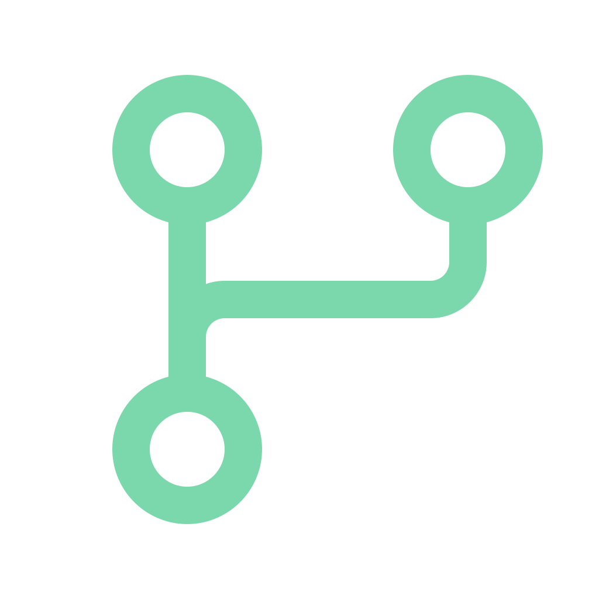
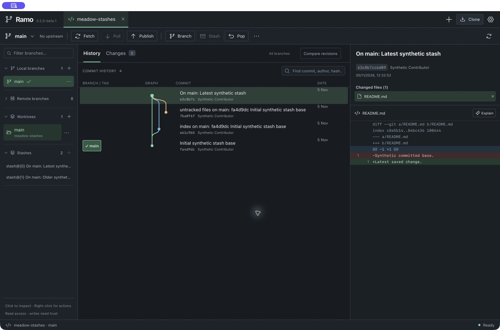

<div align="center">



# Ramo

**A clearer view of your Git workflow.**

An open-source desktop Git client with a visual history, a real merge editor,
and optional AI assistance using your own tools.

[](https://github.com/peppoasap/ramo/actions/workflows/check.yml)
[](LICENSE)
[](CHANGELOG.md)

[Features](#your-everyday-git-work) · [Get started](#get-started) · [AI](#your-tools-your-ai) · [Roadmap](docs/ROADMAP.md) · [Contribute](CONTRIBUTING.md)

</div>



*Actual macOS application with a disposable synthetic repository. No customer data.*

Ramo brings history, branches and changes into one focused workspace. Inspect a
commit, compare branches, resolve a conflict or prepare your next commit without
leaving the graph. Core Git works locally, with no Ramo account or AI subscription.

> **Early beta · 0.2.0-beta.4.** Ramo performs real Git operations. Start with a
> test repository or a backed-up copy. macOS Apple Silicon has local build and
> runtime evidence; Windows and Linux are CI targets awaiting platform acceptance.
> Public source availability does not mean a stable or signed desktop release.

## Your everyday Git work

| Workflow | What you can do |
| --- | --- |
| **Read the graph** | Follow actual commit topology, branches and tags. Search loaded history and inspect files and diffs. |
| **Work with branches** | Double-click to checkout. Create, rename, create tracking branches and delete merged branches through contextual menus. |
| **Keep actions close** | Fetch, Pull, Push/Publish, Branch, Stash and reviewed Pop in the toolbar. Right-click and keyboard menus expose more actions. |
| **Compare and drag** | Compare revisions or changes since a common ancestor. Drag branches/commits to compare or review a merge/cherry-pick. Drops open a review before changing Git. |
| **Prepare a commit** | Stage and unstage files or text hunks. Commit the index, recover local message drafts and review an amend of the last eligible commit. |
| **Resolve a merge** | Compare both sources in a code editor, choose blocks or individual source lines, edit the result, review/save/stage, then complete or abort. |
| **Handle interrupted work** | Continue, skip or abort supported cherry-pick/revert sequences. Inspect and apply/pop/drop stashes, including saved untracked files. |
| **Use multiple checkouts** | Open recent repositories and linked worktrees. Create and manage guarded worktrees without moving your current changes. |
| **Connect a repository** | Clone by URL, provider shortcut or local folder. Browse GitHub repositories explicitly through your installed `gh` CLI; inspect and configure ordinary remote URLs. |

Read the [feature coverage](docs/FEATURES.md) for supported cases and the
[architecture](docs/ARCHITECTURE.md) for how operations are guarded.

## Your tools, your AI

AI is available for commit messages, diff explanations and conflict assistance.
Choose a provider in **AI settings**, review the exact input, then decide whether
to use its suggestion. A suggestion never authorizes a Git operation.

| Provider | Connection | Current verification |
| --- | --- | --- |
| **Codex** | Your installed, signed-in Codex CLI **0.166.0** | One authorized live synthetic commit-drafting check; compatibility checked before sending a diff. |
| **Claude** | Your CLI with `--bare` support and `ANTHROPIC_API_KEY` in the app environment | Adapter implemented; live generation unverified. API billing is separate from a subscription. |
| **Ollama** | Your local service and downloaded model | Adapter implemented; live generation unverified. |

Ramo does not import another app's credentials. Provider CLIs, API keys, sessions
and models are not bundled. There is no automatic inference; provider costs and
usage limits still apply. Stop cancels local request handling, but cannot undo
usage already processed by a provider. See [AI setup and boundaries](docs/AI.md).

## Get started

### Try a build

Open [Actions](https://github.com/peppoasap/ramo/actions/workflows/check.yml), select a
**successful** run for the revision you want, and download its `ramo-macOS`,
`ramo-Windows` or `ramo-Linux` artifact. Artifacts appear only after their platform
job passes; downloading them may require signing in to GitHub. Each includes
installer checksums. An artifact is an unsigned test candidate, not runtime
acceptance of that platform.

Official release assets, when published, will appear under
[Releases](https://github.com/peppoasap/ramo/releases). No automatic updater is configured.

- **macOS Apple Silicon:** local beta packaging has been exercised. Ad-hoc signing
  is not Developer ID signing or Apple notarization. First downloaded launch on a
  second Mac remains unverified. See [Apple's guidance](https://support.apple.com/102445)
  if macOS blocks an app; do not disable system protections globally.
- **Windows / Linux / Intel Mac:** build and installation/runtime acceptance must
  be recorded separately. A green CI build alone does not establish support.
- **Git must be installed.** Packaged users do not need Node or Rust. Existing Git
  credential helpers and SSH agent handle remote credentials; hosted authentication
  still needs broader testing.

### Build from source

Install Git, Node **22.12+ in the 22.x series, 24.x or 26+**, npm, Rust **1.95+**, and
the [Tauri native prerequisites](https://v2.tauri.app/start/prerequisites/) for your OS.

```sh
git clone https://github.com/peppoasap/ramo.git
cd ramo
npm ci
npm run desktop
```

Open a repository, inspect the history and choose whether to trust it. Trust is
requested once per opening and lasts until closing the repository or app. Read-only
inspection remains available. Trusted Git operations can run the repository's
configured hooks, filters and credential helpers under your user account.

```sh
npm run check:release
npm test
npm run test:git
npm run build
npm run audit:dependencies
```

Package the format for your target (the CI uses these same commands):

| Target | Command |
| --- | --- |
| macOS DMG | `npm run bundle -- --bundles dmg` |
| Windows setup.exe | `npm run bundle -- --bundles nsis` |
| Linux DEB | `npm run bundle -- --bundles deb` |

Installers are written to `src-tauri/target/release/bundle/`. On macOS,
`npm run package:mac:local` creates an ad-hoc DMG. Windows has a
[PowerShell packaging guide](docs/WINDOWS-BUILD.md). Build commands do not publish
anything or install provider tools.

For a disposable merge example, run `python3 scripts/create-conflict-fixture.py --code`
and open the printed folder. Fixture scripts create synthetic repositories in
system temporary directories; they do not mutate your own repositories.

## Where the beta stands

Local macOS verification for beta.2: **60 frontend tests**, **125 backend tests**,
production build, DMG integrity/signature/resource checks and native app launch.
The npm audit on 2026-11-05 reported no known vulnerabilities. These results do
not certify security or substitute for platform installation tests.

The main gaps are individual-line **staging**, reviewed discard with recovery,
file history/blame, reflog/reset recovery and guided rebase. Individual-line
**selection in the merge editor** is already available. Binary/symlink/submodule
conflicts require external tools. Long clones have a timeout and no exposed Stop;
failures may leave a partial destination. Hosted authentication, large repositories
and cross-platform behavior need more acceptance work.

Ramo is an independent project. It does not claim full GitKraken parity or a
measured speed advantage. See the [roadmap](docs/ROADMAP.md),
[beta checklist](docs/BETA-CHECKLIST.md) and [changelog](CHANGELOG.md).

## Next on the roadmap

| Next step | Planned work |
| --- | --- |
| **Finish the daily essentials** | Individual-line staging, reviewed discard with a recoverable backup, file history and blame. |
| **Make recovery easier** | Reflog browsing, reviewed reset/recovery and guided rebase with conflict continuation. |
| **Broaden integration and delivery** | More provider catalogs, smoother hosted authentication, file watching and verified Windows/Linux installers. |

These are planned slices, not completed features or dated commitments. Each ships
with preservation tests and documented limits. The [full roadmap](docs/ROADMAP.md)
and [current status](STATUS.md) track the next reviewable task.

## Contribute

Small, complete improvements are welcome. Read [CONTRIBUTING.md](CONTRIBUTING.md)
and [STATUS.md](STATUS.md) before changing behavior. Code, public documentation
and initial UI terminology are English.

- Report reproducible bugs with synthetic examples in [Issues](https://github.com/peppoasap/ramo/issues).
- Include actual checks and screenshots for visible changes; preserve work on failure.
- Keep AI optional and explicit. CI needs no AI account, credentials or paid inference.
- For sensitive findings, follow [SECURITY.md](SECURITY.md). Never post private diffs or credentials.

Built with **Tauri 2 · React · TypeScript · Rust · Git · CodeMirror**.

## License

[Apache License 2.0](LICENSE). Original project notices are in [NOTICE](NOTICE).
Third-party licenses remain their own; [dependency notices](THIRD_PARTY_NOTICES.txt)
are regenerated for each native build target. No GitKraken code, branding or
private reference screenshots are distributed with Ramo.
