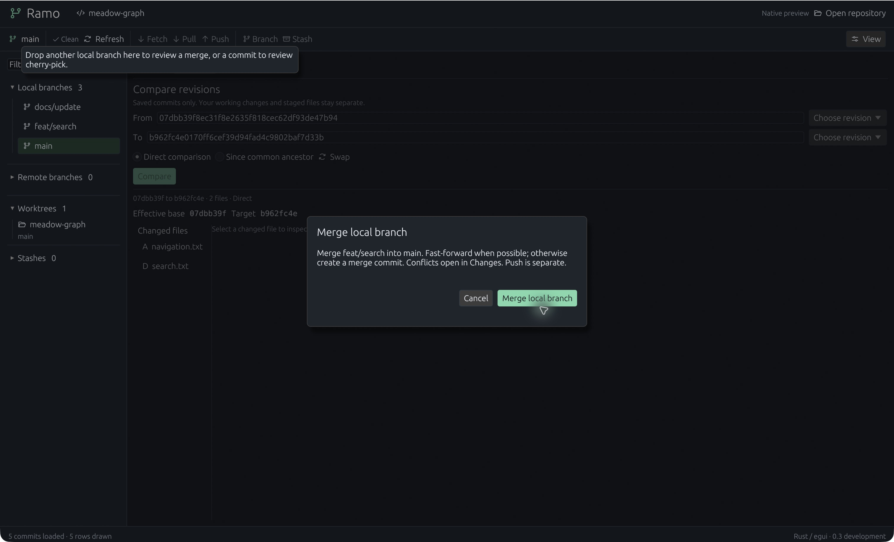
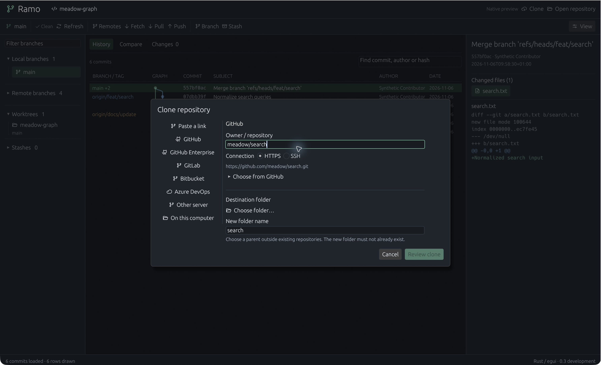
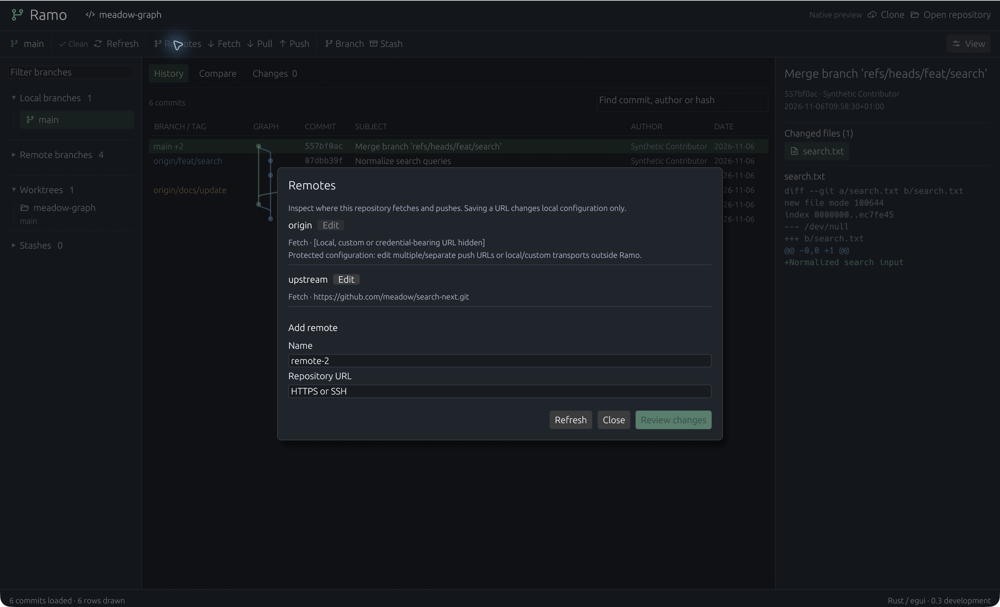

# Rust-native verification — 5 November 2026

Scope: `apps/native`0.3.0-dev.1, macOS arm64 development build. Existing beta.4
remains the released functional application. No new installer is published.

| Gate | Evidence |
|---|---|
| Native behavior |14 tests passed, locked/offline |
| Existing core |127 tests passed, no-default-features; loopback fixtures required sandbox escalation |
| Static checks |Native rustfmt and clippy all targets/no-deps with warnings denied passed |
| Native GUI |5011 real synthetic commits loaded;32 visible rows at22px; search and keyboard navigation exercised |
| Merge GUI |Single current-source line7 replaced only first of two conflicts; undo/redo; manual editing; Unicode paste; saved draft restored after restart |
| Preservation |Both fixtures retained HEAD, Git stage entries, status and working-file bytes; conflict index byte-identical; history index binary changed, consistent with stat-cache refresh |
| Notices |Collected266 notice entries on macOS, including bundled font/icon terms; these include build/optional inputs, not an exact runtime dependency count |
| Other OS |CI configured; hosted outcomes must be checked separately. No Windows/Linux GUI acceptance |

Commands: `cargo test --manifest-path apps/native/Cargo.toml --locked --offline`,
`cargo clippy --manifest-path apps/native/Cargo.toml --locked --offline --all-targets --no-deps -- -D warnings`,
`cargo fmt --manifest-path apps/native/Cargo.toml --check`, and
`cargo test --manifest-path src-tauri/Cargo.toml --no-default-features --locked --offline -- --test-threads=4`.

The GUI used disposable Meadow fixtures created by the repository scripts. No
customer repository, credential or provider inference was used. Japanese/emoji
clipboard input was observed; this does not establish IME composition support.
Draft tests cover conflict/corruption/competition and explicit restore; they do
not prove crash durability on every filesystem. Diff previews render visible
rows and cap display at12000 lines and4096 characters per line with a notice.

Images are actual captures with only macOS window chrome cropped away. See
[design comparison](../design-qa.md). No performance ratio against GitKraken is
claimed: pagination/row counts are functional evidence, not comparative timings.

Remaining migration gates: Git write/network/AI UI parity, save/stage/complete
merge, source-linked scrolling, language tooling, typed CRLF, large-file editor
performance, accessibility/IME, legacy draft import and platform runtime checks.

## Publication evidence

Native source published as commit `e3bf258`. Hosted validation was started in
[Native CI run42101596287](https://github.com/peppoasap/ramo/actions/runs/42101596287)
and [existing desktop CI](https://github.com/peppoasap/ramo/actions/runs/42101596129);
at this handoff they remain in progress, not counted as passed. A fresh temporary
`git archive` source export included the native manifest, lockfile and editor and
excluded target/state directories. Existing frozen release assets were untouched.

## Daily writes and merge completion — subsequent implementation

The initial native CI run42101596287 completed successfully on all three OS.
The next source slice adds writes; its local suite has16 passing tests and clean
clippy. Native GUI on macOS completed the real two-conflict synthetic merge through
editor Save and stage and Changes Complete merge, including a result identical
to current HEAD. Git independently confirmed a new two-parent commit and a clean
working tree. The same opening then checked out `side` by double-click and
staged/unstaged a synthetic file with no additional trust confirmation. Trust
was requested again after a deliberate app restart, as designed.

New worker tests prove trust/freshness rejection, index-only commits preserving
unstaged bytes, merge-error conflict refresh and reviewed resolution/commit while
preserving untracked bytes. Network/stash UI is wired but has not had an end-to-end
native hosted-authentication check. No platform GUI or performance parity is claimed.

## Precise staging — 5 November 2026

131 core tests and17 native tests passed locally. Added integration cases exercise
all seven non-empty subsets of a replacement for both staging directions, CRLF,
Unicode and literal diff-like text, independent hunk offsets, empty tracked files,
stale hashes, metadata row refusal and missing EOF refusal. Native gutter positions
have a fixture. Native clippy/fmt passed; optional expanded core all-target clippy
reported existing test-read/style findings in ai.rs, local_ai.rs and process.rs.

The actual macOS UI staged just `+updated02`, preserving `line02` and the later
replacement in working data; unstaging that row returned the index to HEAD. Then
Shift selection staged the first replacement pair, leaving the second hunk alone.
Whole-hunk stage and unstage were also exercised. Shell assertions independently
compared the index and working bytes. The screen-reader tree showed checkbox
states off/on accurately after a widget metadata fix. Button padding was reduced
to keep controls within the22px rows; Phosphor supplies the selected check icon.

Partial staging supports modified regular text and diffs up to256KiB. No-final-
newline line selection falls back to complete hunks; new/deleted/renamed/binary
and mode-changing files use whole-file actions. These explicit boundaries do not
close the full completion ledger or establish native platform GUI parity.

Native partial controls are disabled for clipped previews (over12,000 lines or
4,096 characters per line) and during an active Git operation, with a visible
whole-file fallback reason. Complete working files are never rewritten by staging.

## Composer, object actions and guarded Quit — 6 November 2026

Local macOS arm64:22 native tests passed; native all-target nodeps clippy, format,
266 dependency notices and developer-bundle build/signature checks passed. The five
additional tests cover composer acknowledgements/clear, storage restart/competition,
staged amend preserving unstaged work and cherry-pick conflict resolution/continue
preserving untracked data. Core source is unchanged in this slice; its131-test local
result above is prior evidence. Previous staging revision5ed20e9 passed native/core
CI on all three OS in run42119232111; new changes require a separate run.

Actual GUI on a disposable repository amended the eligible local HEAD with a new
full message. Git independently confirmed the previous HEAD recovery ref, staged
content in the rewritten commit and unchanged unstaged file bytes. Main-composer
text survived amend. A deliberate immediate Unicode paste/Cmd-Q test first exposed
lost typing in eframe's macOS termination route. After routing this app's Quit menu
through the cancellable close event, exact text survived termination/restart;
HEAD, logical index entries, status and working bytes were preserved.

A subsequent GUI stage and normal commit used that recovered message. Independent
Git assertions confirmed the exact Unicode commit message, clean status/index,
expected working bytes and an empty persisted commit draft. The latest modal was
visually inspected after correcting light-system palette selection; Escape closes
it and mutations unavailable with dirty data remain disabled.

Image is3024×1836 after removing only the62px OS strip from the raw3024×1898
capture; no mock composition. It illustrates the dialog, not dense-history parity.
Repository-switch/error-reload GUI paths, dirty-merge Quit, Windows/Linux runtime,
IME and force-kill/shutdown durability are not established by these checks.
No hosted-account inference or installer acceptance was performed.

## Saved-revision comparison — 6 November 2026

24 native tests pass. The new real-Git worker fixture compares divergent commits
in direct and unique-ancestor modes after moving a branch ref, with dirty index
and working data. HEAD, binary index, status and working bytes remain unchanged;
local uncommitted content is absent from the saved-tree diff. Revision expressions
are refused. A state test rejects obsolete pair/file results. Existing core compare
fixtures additionally cover unrelated/multiple ancestors, literal paths, binary
summaries and bounded previews; those core tests were not rerun locally this slice.

Actual macOS GUI selected From using an old commit menu, To using a branch menu,
compared and inspected the changed file. Swap cleared the old result; comparing
again reversed the visible deletion/addition. Both revision pickers and the
common-ancestor mode were exercised in the subsequent bundle. A missing arrow
font glyph was replaced with plain text; effective object IDs were shortened
with full IDs on hover. Immediate popup closure after selection was also observed in the final bundle.

This is an actual synthetic repository capture, cropped only to remove the OS
strip. No mergeability, uncommitted comparison, drag/drop, platform GUI parity or
matched GitKraken speed claim follows. Preview limits remain core-owned:512KiB
text diff, rename as delete/add and binary summary. Choice list is bounded to
1,000 entries with context-menu/full-ID alternatives. Queued read jobs are not
cancelled; their stale results are rejected. No new provider inference or release.

## Reviewed native graph gestures — 6 November 2026

28 native tests, native clippy/fmt,266 notices and developer-bundle build/strict
signature checks pass locally; release metadata remains beta.4. Added real-Git intent cases cover source identity,
current/head/merge/remote refusal, dirty comparison versus mutation, detached and
interrupted-operation states, stale repository/fingerprint and no Git changes from
intent creation. Headless egui tests reproduce a single input batch containing
press, movement and release; they prove the captured source remains correct.
They also exercise Escape, pointer-gone, focus loss, busy and changed snapshots.
These headless cases are not OS-level gesture/accessibility acceptance.

Actual macOS GUI first compared commits by dragging. Branch drags exposed a
coalesced-event defect: press_origin had already cleared before source rendering,
so default widget drag-start lost or misidentified the source. Capturing the raw
press event and resolving release against collected visible geometry fixed the
reproduced case. Final trials correctly compared sidebar branch and graph branch
label against a different commit. Drops on the toolbar's named current branch
opened exact merge/cherry-pick reviews. Initial trust did not execute the merge;
Cancel preserved HEAD, logical index entries, status and working bytes, checked
independently against a captured baseline.

A subsequent reviewed drag merge on the disposable divergent fixture produced
a two-parent commit: first parent previous main, second parent feat/search. Main
remained checked out; original README/navigation bytes survived, expected search
content appeared, and index/status were clean. Temporary diagnostic logs were
removed from source. Actual review screenshot (only OS strip cropped):

No multi-object drag, graph auto-scroll or arbitrary-branch mutation target. No
external file/text payload, auto-checkout, rebase/reset or push gesture. Broader
keyboard/context-menu activation and actual Windows/Linux gestures remain open.
Previous comparison revision0959be3 passed native/core and legacy desktop CI on
all three OS; the gesture source needs its own hosted run. No new native release.

The final developer bundle was rebuilt after pointer-cancellation and bounded-
overlay refinements; sidebar docs/update → current merge commit correctly opened
the ordered comparison. This final read-only check used the resulting synthetic
merge fixture; it did not repeat or reset the merge.

## Native clone and remote configuration — 6 November 2026

31 native tests, native clippy/fmt,266 dependency notices, developer-bundle
build/strict signature and release metadata passed locally. New real-Git local
clone jobs run with no registered current repository. The test proves review has no
destination side effect, source bytes/index/HEAD are preserved, committed content
is cloned with fresh trust, replay is refused and post-review directory collisions
preserve existing files. Remote worker tests prove trust/freshness checks, staged/
unstaged preservation, URL redaction and refusal to overwrite separate push config.
Provider shortcut fixtures cover HTTPS/SSH/Azure and injected-host/path refusal.
No native file picker or hosted-account behavior follows from fixture tests alone.

Actual macOS GUI selected the disposable source and a new parent using native
folder pickers. Review created no destination. Final clone opened automatically
with matching committed HEAD and clean status; independent checks proved source
HEAD, logical index entries, status and working bytes unchanged. A Unicode message
saved before clone remained in the original repository's draft record; the clone
composer was empty. Remote add then edit requested trust once for the new opening,
showed exact URL reviews and updated only local configuration. Local origin was
protected and retained. Independent Git checks confirmed the reviewed URLs and
preserved commit/files; no fetch or push was run.

Inspection found a vertical separator expanding the clone dialog beyond the
viewport; a finite divider and bounded content height restored a visible footer.
Later refinement blocks keyboard/pointer actions in underlying panels, suggests
unused remote names and avoids unchanged-URL reviews. Actual final screenshots
and late-bundle observations are recorded with the source handoff.

Installed-Git/GitHub CLI account authentication, actual GitHub catalog loading,
Windows/Linux GUI, clone Stop/streamed progress and shallow/sparse options remain
separate gates. Other providers are URL shortcuts. No login/install, credential
scraping, live AI, native installer or GitKraken speed claim occurred. Previous
graph sourcedd26141 passed native/core CI42192129115 on all three OS; new connection
source needs its own hosted run.

Final bundle observations: clone/provider fields generate the expected HTTPS URL
and folder suggestion for a synthetic owner/repository. Opening the optional
catalog exposes its explicit Load button without making a request. Toolbar,
sidebar, graph and inspector actions are disabled behind these dialogs. Remote
Refresh was exercised after an external synthetic configuration change, followed
by a successful reviewed URL update with unrelated remote/files preserved. This
proves the repository snapshot also refreshes, rather than only the visible list.

Both are actual3024×1898 captures with only the62px OS strip removed. The clone
image illustrates URL setup without a selected destination; it is not a hosted
clone or connected-account claim. Native file-picker screenshots were not exported.

## Visual correction — 6 November 2026

See root design-qa.md and docs/design/rust-native/VISUAL-CONTRACT.md. Actual macOS
history before/after uses matching1512×918 logical content, synthetic55 commits,
selected feat/search and read-only inspector.32 native tests, native clippy/fmt,
bundle/signature and267 notices passed. Toolbar search was exercised; branch
inspection/context menu, branch/clone Cancel and window resize were observed.
Independent Git HEAD/index entries/status stayed unchanged. Dedicated Changes,
comparison, merge and future AI/settings visual passes remain open. No platform
GUI acceptance or new native installer follows from this pass.

Previous native CI42196287619 passed macOS/Linux but Windows failed a synthetic
clone LF assertion: global autocrlf affects the new checkout, while source-local
config is not cloned. The test now commits explicit eol=lf attributes. Production
Git behavior is unchanged; a fresh hosted run is required for Windows evidence.

## Changes and merge fidelity — 6 November 2026

Root design-qa.md records matched before/after captures on actual macOS and selected
workflow-board crops. Native32 tests, clippy/fmt and developer-bundle build/signature
plus267 notices pass. GUI staged raw diff rows9/10 only and unstage restored the
original index/status, while HEAD and work bytes stayed unchanged. A Unicode
message saved and reopened. Resizing to1002×683 logical kept action controls visible.

Real two-file conflict: source line pick, manual editing, Undo/Redo, cancellable
dirty file switch/Cmd-Q, local draft save and old-fingerprint restore were observed.
Git independently verified draft-only actions did not change the repo. Explicit
save/stage resolved both files; the resolved synthetic Rust test passed. Complete
merge produced the two expected parents, exact result bytes, clean status and no
MERGE_HEAD. No account/inference/network action. See
[scoped evidence](verification/native-workflow-ui.json) and root design-qa.md.

Previous source5c91b59 passed native/core42199162572 and legacy42199162408 on all
three OS. Fresh workflow source CI is pending; GUI evidence remains macOS only.
Full comparison/settings/AI visual gates and native release remain incomplete.

## Comparison refinement — 6 November 2026

Actual macOS read-only comparison verified searchable selectors, stable names and
pinned IDs, automatic first diff, direct/swap/common-ancestor modes, three-file
selection, same-commit empty state, invalid input recovery and narrow layout.
The core's effective base and changed-file list matched independent Git. A
controlled external synthetic ref move did not change the pinned comparison;
that ref was restored, then HEAD/index entries/status/working hashes checked.
No UI mutation/provider/network action.34 native tests, clippy/fmt, bundle/signature
and267 notices pass. Root design-qa.md includes combined actual/reference evidence
and exact scope; comparison has no dedicated source mock to claim pixel parity.

Refresh in the same repository preserves the selected immutable pair and preview,
including after a controlled external ref move. Opening a different synthetic
repository clears both endpoints; returning does not reuse the other repository’s
comparison. Both cases were verified in the actual macOS app.

Sourcec7091c2 native/core42203220979 and legacy42203221057 passed all three OS.
This new source needs fresh CI; platform GUI/release and full native completion
remain separate. See [comparison proof](verification/native-comparison-ui.json).

## Worktree workflow — 6 November 2026

36 native tests pass, including worker coverage of membership/parent grants/trust,
collision preservation, open-checkout/untracked removal refusal and clean removal
with source bytes/index preserved. The test uses the exact reviewed worktree path;
macOS temporary aliases must not bypass the core's reviewed-path requirement.
Native fmt/clippy, developer bundle strict signature and267 notices pass.

Actual macOS created work/search in a separate checkout, locked/unlocked it,
verified disabled removal while locked, opened/returned and recovered a Unicode
local composer message. Removing another checkout with an ignored sentinel was
refused; removing the clean created checkout succeeded while retaining its branch.
A second creation used that available existing branch. Independent Git agreed
with checkout/branch/clean state and confirmed source HEAD/index tree, working/
untracked bytes and ignored sentinel hashes unchanged. No AI/network action.
[Proof](verification/native-worktrees-ui.json) and root design-qa.md record scope.
Repository tabs/recents, Windows/Linux GUI and native release remain incomplete.
Previousfa2a53a native42208900871 and legacy42208900858 pass all three OS; the
new worktree revision requires separate hosted results.

## Repository tabs and opening trust — 6 November 2026

38 native tests pass. Worker tests verify two live registrations retain separate
trust, activation observes external edits, canonical duplicate opens reuse ID,
close invalidates activation and trust, durable recent paths reject arbitrary
paths and reopen untrusted after backend restart. Model tests cover duplicate
tabs, active overflow selection, close/reopen prompting. Existing mutation test
now verifies trust both retained while open and reset after explicit close.
Native fmt/clippy, bundle strict signature and267 notices pass.

Actual macOS exercised four tabs and narrow +2 overflow, filter/Changes-file/
immutable-comparison restoration, external edit freshness (edit restored), Unicode
composer recovery on switch/restart, missing-recent error preserving active view,
last close and Refresh context. A real synthetic conflict verified switch/Cmd-W
keep-editing and explicit discard of memory only; closing an inactive tab kept
the active result. Final opening-trust UI verified read-only no-repeat activation,
trusted activation, new consent after close/reopen and queued branch review after
trust acceptance. Independent Git confirms no such branch created and preserves
source HEAD/index tree/work/untracked/ignored bytes, comparison fixture state and
conflict HEAD/index/work/MERGE_HEAD. No merge was saved/staged/completed in this pass.
See [synthetic proof](verification/native-tabs-ui.json) and root design-qa.md.

Previousa1eb21c native42210758879 and legacy42210758750 pass all three OS; this
source needs its own CI. Native GUI evidence remains macOS only. Views/open tabs
are in-memory, automatic workspace restart restoration is pending; recents/drafts
are durable. No AI request, native installer/tag/release or full-goal completion.
