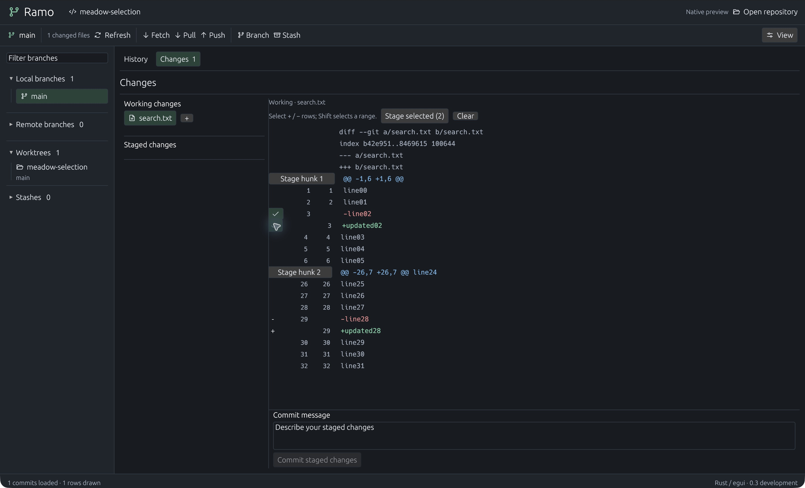
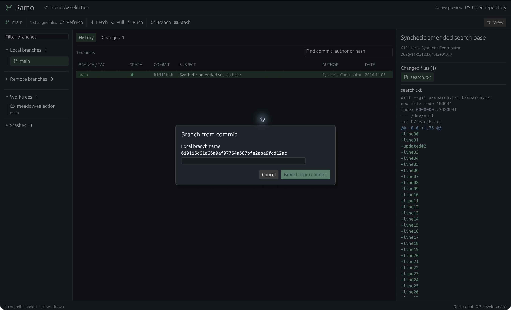
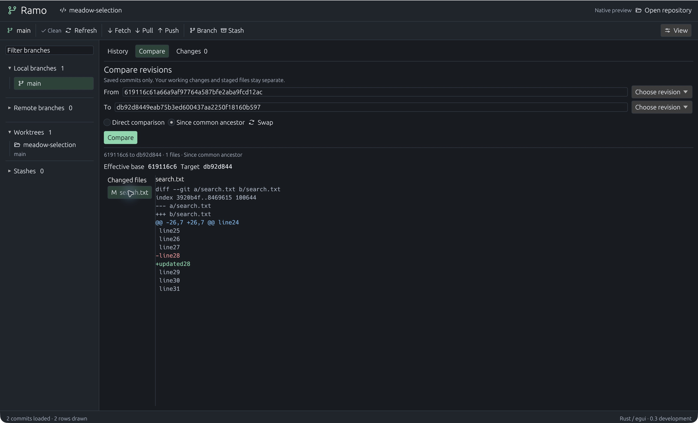

# Rust-native verification — 5 November 2026

Scope: `apps/native`0.3.0-dev.1, macOS arm64 development build. Existing beta.4
remains the released functional application. No new installer is published.

| Gate | Evidence |
|---|---|
| Native behavior |14 tests passed, locked/offline |
| Existing core |127 tests passed, no-default-features; loopback fixtures required sandbox escalation |
| Static checks |Native rustfmt and clippy all targets/no-deps with warnings denied passed |
| Native GUI |5011 real synthetic commits loaded;32 visible rows at22px; search and keyboard navigation exercised |
| Merge GUI |Single current-source line7 replaced only first of two conflicts; undo/redo; manual editing; Unicode paste; saved draft restored after restart |
| Preservation |Both fixtures retained HEAD, Git stage entries, status and working-file bytes; conflict index byte-identical; history index binary changed, consistent with stat-cache refresh |
| Notices |Collected266 notice entries on macOS, including bundled font/icon terms; these include build/optional inputs, not an exact runtime dependency count |
| Other OS |CI configured; hosted outcomes must be checked separately. No Windows/Linux GUI acceptance |

Commands: `cargo test --manifest-path apps/native/Cargo.toml --locked --offline`,
`cargo clippy --manifest-path apps/native/Cargo.toml --locked --offline --all-targets --no-deps -- -D warnings`,
`cargo fmt --manifest-path apps/native/Cargo.toml --check`, and
`cargo test --manifest-path src-tauri/Cargo.toml --no-default-features --locked --offline -- --test-threads=4`.

The GUI used disposable Meadow fixtures created by the repository scripts. No
customer repository, credential or provider inference was used. Japanese/emoji
clipboard input was observed; this does not establish IME composition support.
Draft tests cover conflict/corruption/competition and explicit restore; they do
not prove crash durability on every filesystem. Diff previews render visible
rows and cap display at12000 lines and4096 characters per line with a notice.

Images are actual captures with only macOS window chrome cropped away. See
[design comparison](../design-qa.md). No performance ratio against GitKraken is
claimed: pagination/row counts are functional evidence, not comparative timings.

Remaining migration gates: Git write/network/AI UI parity, save/stage/complete
merge, source-linked scrolling, language tooling, typed CRLF, large-file editor
performance, accessibility/IME, legacy draft import and platform runtime checks.

## Publication evidence

Native source published as commit `e3bf258`. Hosted validation was started in
[Native CI run42101596287](https://github.com/peppoasap/ramo/actions/runs/42101596287)
and [existing desktop CI](https://github.com/peppoasap/ramo/actions/runs/42101596129);
at this handoff they remain in progress, not counted as passed. A fresh temporary
`git archive` source export included the native manifest, lockfile and editor and
excluded target/state directories. Existing frozen release assets were untouched.

## Daily writes and merge completion — subsequent implementation

The initial native CI run42101596287 completed successfully on all three OS.
The next source slice adds writes; its local suite has16 passing tests and clean
clippy. Native GUI on macOS completed the real two-conflict synthetic merge through
editor Save and stage and Changes Complete merge, including a result identical
to current HEAD. Git independently confirmed a new two-parent commit and a clean
working tree. The same opening then checked out `side` by double-click and
staged/unstaged a synthetic file with no additional trust confirmation. Trust
was requested again after a deliberate app restart, as designed.

New worker tests prove trust/freshness rejection, index-only commits preserving
unstaged bytes, merge-error conflict refresh and reviewed resolution/commit while
preserving untracked bytes. Network/stash UI is wired but has not had an end-to-end
native hosted-authentication check. No platform GUI or performance parity is claimed.

## Precise staging — 5 November 2026

131 core tests and17 native tests passed locally. Added integration cases exercise
all seven non-empty subsets of a replacement for both staging directions, CRLF,
Unicode and literal diff-like text, independent hunk offsets, empty tracked files,
stale hashes, metadata row refusal and missing EOF refusal. Native gutter positions
have a fixture. Native clippy/fmt passed; optional expanded core all-target clippy
reported existing test-read/style findings in ai.rs, local_ai.rs and process.rs.

The actual macOS UI staged just `+updated02`, preserving `line02` and the later
replacement in working data; unstaging that row returned the index to HEAD. Then
Shift selection staged the first replacement pair, leaving the second hunk alone.
Whole-hunk stage and unstage were also exercised. Shell assertions independently
compared the index and working bytes. The screen-reader tree showed checkbox
states off/on accurately after a widget metadata fix. Button padding was reduced
to keep controls within the22px rows; Phosphor supplies the selected check icon.

Partial staging supports modified regular text and diffs up to256KiB. No-final-
newline line selection falls back to complete hunks; new/deleted/renamed/binary
and mode-changing files use whole-file actions. These explicit boundaries do not
close the full completion ledger or establish native platform GUI parity.

Native partial controls are disabled for clipped previews (over12,000 lines or
4,096 characters per line) and during an active Git operation, with a visible
whole-file fallback reason. Complete working files are never rewritten by staging.

## Composer, object actions and guarded Quit — 6 November 2026

Local macOS arm64:22 native tests passed; native all-target nodeps clippy, format,
266 dependency notices and developer-bundle build/signature checks passed. The five
additional tests cover composer acknowledgements/clear, storage restart/competition,
staged amend preserving unstaged work and cherry-pick conflict resolution/continue
preserving untracked data. Core source is unchanged in this slice; its131-test local
result above is prior evidence. Previous staging revision5ed20e9 passed native/core
CI on all three OS in run42119232111; new changes require a separate run.

Actual GUI on a disposable repository amended the eligible local HEAD with a new
full message. Git independently confirmed the previous HEAD recovery ref, staged
content in the rewritten commit and unchanged unstaged file bytes. Main-composer
text survived amend. A deliberate immediate Unicode paste/Cmd-Q test first exposed
lost typing in eframe's macOS termination route. After routing this app's Quit menu
through the cancellable close event, exact text survived termination/restart;
HEAD, logical index entries, status and working bytes were preserved.

A subsequent GUI stage and normal commit used that recovered message. Independent
Git assertions confirmed the exact Unicode commit message, clean status/index,
expected working bytes and an empty persisted commit draft. The latest modal was
visually inspected after correcting light-system palette selection; Escape closes
it and mutations unavailable with dirty data remain disabled.

Image is3024×1836 after removing only the62px OS strip from the raw3024×1898
capture; no mock composition. It illustrates the dialog, not dense-history parity.
Repository-switch/error-reload GUI paths, dirty-merge Quit, Windows/Linux runtime,
IME and force-kill/shutdown durability are not established by these checks.
No hosted-account inference or installer acceptance was performed.

## Saved-revision comparison — 6 November 2026

24 native tests pass. The new real-Git worker fixture compares divergent commits
in direct and unique-ancestor modes after moving a branch ref, with dirty index
and working data. HEAD, binary index, status and working bytes remain unchanged;
local uncommitted content is absent from the saved-tree diff. Revision expressions
are refused. A state test rejects obsolete pair/file results. Existing core compare
fixtures additionally cover unrelated/multiple ancestors, literal paths, binary
summaries and bounded previews; those core tests were not rerun locally this slice.

Actual macOS GUI selected From using an old commit menu, To using a branch menu,
compared and inspected the changed file. Swap cleared the old result; comparing
again reversed the visible deletion/addition. Both revision pickers and the
common-ancestor mode were exercised in the subsequent bundle. A missing arrow
font glyph was replaced with plain text; effective object IDs were shortened
with full IDs on hover. Immediate popup closure after selection was also observed in the final bundle.

This is an actual synthetic repository capture, cropped only to remove the OS
strip. No mergeability, uncommitted comparison, drag/drop, platform GUI parity or
matched GitKraken speed claim follows. Preview limits remain core-owned:512KiB
text diff, rename as delete/add and binary summary. Choice list is bounded to
1,000 entries with context-menu/full-ID alternatives. Queued read jobs are not
cancelled; their stale results are rejected. No new provider inference or release.
