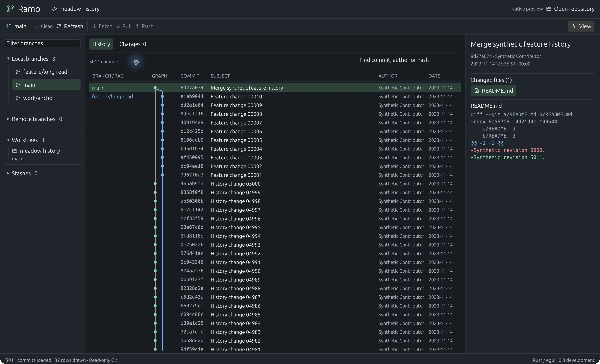
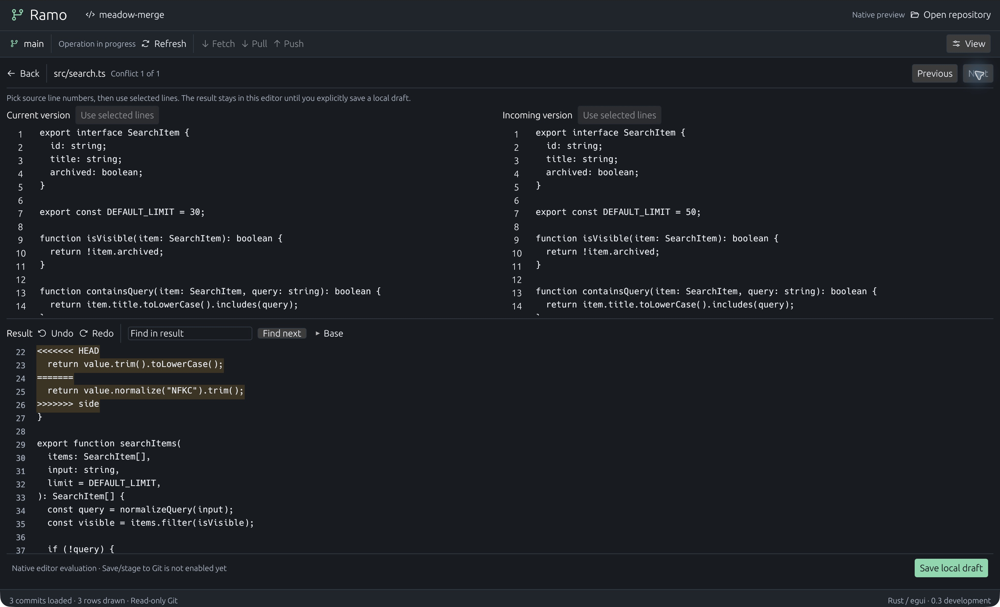
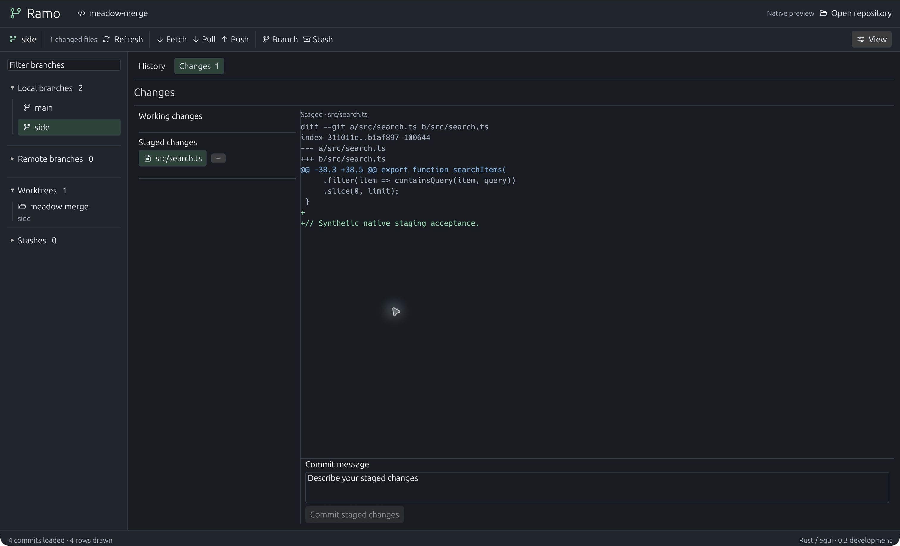

# Rust-native verification — 5 November 2026

Scope: `apps/native`0.3.0-dev.1, macOS arm64 development build. Existing beta.4
remains the released functional application. No new installer is published.

| Gate | Evidence |
|---|---|
| Native behavior |14 tests passed, locked/offline |
| Existing core |127 tests passed, no-default-features; loopback fixtures required sandbox escalation |
| Static checks |Native rustfmt and clippy all targets/no-deps with warnings denied passed |
| Native GUI |5011 real synthetic commits loaded;32 visible rows at22px; search and keyboard navigation exercised |
| Merge GUI |Single current-source line7 replaced only first of two conflicts; undo/redo; manual editing; Unicode paste; saved draft restored after restart |
| Preservation |Both fixtures retained HEAD, Git stage entries, status and working-file bytes; conflict index byte-identical; history index binary changed, consistent with stat-cache refresh |
| Notices |Collected266 notice entries on macOS, including bundled font/icon terms; these include build/optional inputs, not an exact runtime dependency count |
| Other OS |CI configured; hosted outcomes must be checked separately. No Windows/Linux GUI acceptance |

Commands: `cargo test --manifest-path apps/native/Cargo.toml --locked --offline`,
`cargo clippy --manifest-path apps/native/Cargo.toml --locked --offline --all-targets --no-deps -- -D warnings`,
`cargo fmt --manifest-path apps/native/Cargo.toml --check`, and
`cargo test --manifest-path src-tauri/Cargo.toml --no-default-features --locked --offline -- --test-threads=4`.

The GUI used disposable Meadow fixtures created by the repository scripts. No
customer repository, credential or provider inference was used. Japanese/emoji
clipboard input was observed; this does not establish IME composition support.
Draft tests cover conflict/corruption/competition and explicit restore; they do
not prove crash durability on every filesystem. Diff previews render visible
rows and cap display at12000 lines and4096 characters per line with a notice.

Images are actual captures with only macOS window chrome cropped away. See
[design comparison](../design-qa.md). No performance ratio against GitKraken is
claimed: pagination/row counts are functional evidence, not comparative timings.

Remaining migration gates: Git write/network/AI UI parity, save/stage/complete
merge, source-linked scrolling, language tooling, typed CRLF, large-file editor
performance, accessibility/IME, legacy draft import and platform runtime checks.

## Publication evidence

Native source published as commit `e3bf258`. Hosted validation was started in
[Native CI run42101596287](https://github.com/peppoasap/ramo/actions/runs/42101596287)
and [existing desktop CI](https://github.com/peppoasap/ramo/actions/runs/42101596129);
at this handoff they remain in progress, not counted as passed. A fresh temporary
`git archive` source export included the native manifest, lockfile and editor and
excluded target/state directories. Existing frozen release assets were untouched.

## Daily writes and merge completion — subsequent implementation

The initial native CI run42101596287 completed successfully on all three OS.
The next source slice adds writes; its local suite has16 passing tests and clean
clippy. Native GUI on macOS completed the real two-conflict synthetic merge through
editor Save and stage and Changes Complete merge, including a result identical
to current HEAD. Git independently confirmed a new two-parent commit and a clean
working tree. The same opening then checked out `side` by double-click and
staged/unstaged a synthetic file with no additional trust confirmation. Trust
was requested again after a deliberate app restart, as designed.

New worker tests prove trust/freshness rejection, index-only commits preserving
unstaged bytes, merge-error conflict refresh and reviewed resolution/commit while
preserving untracked bytes. Network/stash UI is wired but has not had an end-to-end
native hosted-authentication check. No platform GUI or performance parity is claimed.
