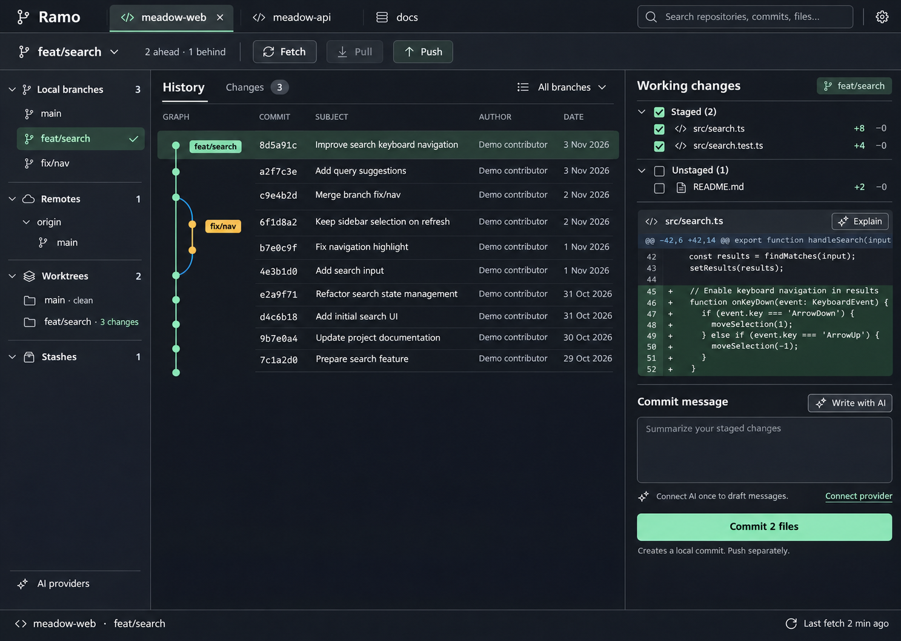

# Design exploration

Created: 2026-11-03. Generated with the built-in OpenAI image-generation tool. All visible repositories, people, diffs and commit data are synthetic.

## Selection record

The user selected the **first displayed original result** and requested built-in contextual AI plus Apache 2.0. The implementation target is that direction with the AI revision below.

| Image | Role |
| --- | --- |
| [01-graph-desk.png](mockups/01-graph-desk.png) | Selected original: graphite/mint, history-centered three-column layout |
| [02-change-desk.png](mockups/02-change-desk.png) | Archived exploration: light theme, changes-centered workflow |
| [03-workspace-desk.png](mockups/03-workspace-desk.png) | Archived exploration: repository/worktree explorer and lower diff |
| [selected-ai.png](mockups/selected-ai.png) | Selected direction revised with contextual AI |

## What these images establish

Hierarchy, palette, layout, density and the placement of task-specific AI actions.

## What these images do not establish

A runnable application, authentic provider connection, real Git data, correct merge topology, executable code, accessibility compliance or completed feature implementation.

The original graph mockup presents a push action while a branch is ahead and behind. Implementation must derive enabled states and conflict messages from real Git data. Generated code and diff line numbering are illustrative. The selected revision combines history context with working changes; the implementation must label those states clearly rather than imply that a selected historical commit is the current index.

Exact prompts and input provenance are preserved in [GENERATION.md](GENERATION.md). The private user-supplied screenshot is deliberately not copied into this project.

