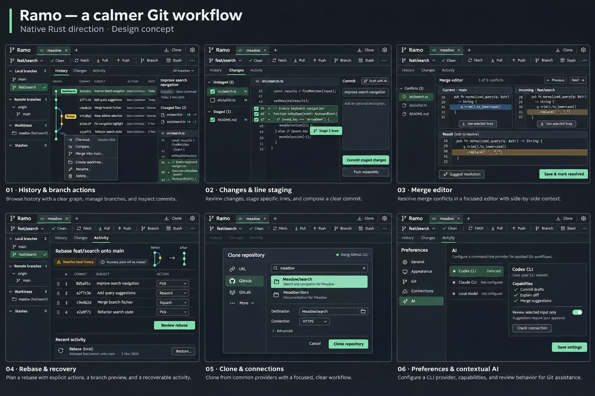

# A calmer Git workflow — Rust-native design concept

Created 2026-11-05 with Product Design and the built-in image generator.
One image, six workflow boards, one visual direction, as requested by the owner.
**Proposed UI, not an implemented native application.** All data is synthetic.

The owner subsequently accepted this direction with a wider viewport and more
visible commits. The [wide history revision](wide-history.png) is the R0 target;
[apps/native](../../../apps/native/README.md) now implements the initial browsing
slice and editor evaluation. Most of this six-board feature surface remains a
proposal; consult the native README for actual coverage. The wide revision was
generated at1717×916, requested1920×1080, and copied unchanged.

## Brief and visual system

Make everyday Git understandable and precise without filling the graph with
controls. Keep the accepted graphite/mint identity and the familiar object
sidebar, working area and optional inspector. Native Rust is the implementation
direction; the image cannot establish toolkit feasibility or performance.

Use #171b20 base, #1e252c panels, #e8edf3 text, #a6b1c0 supporting text,
#7bd8ac emphasis. Selected/proposed tokens: 4px spacing increments; 48px tab bar,
40px command bar, 30–32px controls, 3px button corners and 6px dialogs. Body text
14–16px at actual application scale. Code/hashes alone use monospace. Start with
240px sidebar and 320px inspector, resizable with explicit minima. These are
implementation specifications, not dimensions measured from the generated image.

Flat grouped surfaces and dividers instead of nested cards. Icons get tooltips
and accessible names; keep text on unfamiliar or consequential actions. One
primary action per task, ordinary menus for infrequent commands. Narrow windows
collapse the inspector before shrinking editor text. Verify 960px, 1280px and
1440px windows at 100%, 150% and 200% scaling during implementation.

## Workflow boards

| Board | Proposed UX | Already exists / new work |
| --- | --- | --- |
| History & branch actions | Inline refs with +N overflow; compact context menu; selected commit inspector; clear source/target drag preview | Graph, overflow, direct checkout and branch menus exist; native UI, richer targets/filters/palette remain |
| Changes & line staging | Explicit staged/unstaged files; line/range selection near Stage action; commit composer separate from history | File/hunk staging, drafts and commit exist; line staging remains new |
| Merge editor | Full workspace, two read-only sources plus editable result; gutter picks, conflict navigation, contextual AI | Most semantics exist in CodeMirror; Rust editor must prove parity before cutover |
| Rebase & recovery | Drag handles plus keyboard reorder; Pick/Reword/Squash; before/after preview and specific recovery entry | Proposed rebase/activity/recovery UX; no universal Undo claim |
| Clone & connections | Flat provider list, searchable catalog, destination, collapsed advanced options | Guided clone/GitHub CLI catalog exist; other provider catalogs and smoother auth remain |
| Preferences & contextual AI | Provider requirements/status, small scoped settings, input review and approval | Current adapters/settings exist; proposed layout and native port remain |

## Interaction rules

- Single click inspects, double click checks out an available local branch; no
  extra confirmation for ordinary checkout. Preserve native dirty-state guards.
- Trust once per repository opening, including tab/branch switches. Keep the
  current session-only semantics until a separate persistent-trust design exists.
- File/range stage is direct, with an accurate preview; discard gets a recoverable
  backup and review. Merge/rebase/drop/delete get an impact-specific review.
- Drag shows source, target and intended action, including a forbidden state.
  Support Escape, auto-scroll and the same keyboard/menu command. No hidden checkout.
- Menu, toolbar and palette share action availability and disabled reasons.
- AI requests remain explicit, scoped, cancellable and separate from Git writes.
  Provider detection, authentication and successful inference are distinct states.

## Generated-image limitations to correct in implementation

The raster is 1536×1024 despite a requested 4096×2816 canvas. Read the full image
for layout intent; it is not a pixel-perfect 14px typography or accessibility spec.
Do not upscale it and describe it as a 4K design export.

Code, commit subjects, branch topology and action states are illustrative. The
shared header shows feat/search even where the merge source label says main:
real UI must derive the active/source/target labels from actual Git state. The
rebase drawing includes a merge commit: initial linear rebase must refuse that
case or offer an explicitly supported preserve-merges plan, never silently flatten.

“Review selected input only” is drawn as a switch; selected-input review must not
be optional in implementation. “Detected” means executable availability, not
account authorization. “Push separately” below the commit action is explanatory
text, not another action in this task. The staged/selected lines shown must not
be counted as staged until the actual Git operation succeeds.

## Provenance and handoff

Grounding images: [actual synthetic desktop](../../images/ramo-desktop.jpg) and
[selected original AI direction](../mockups/selected-ai.png), both inspected and
attached to generation. No third-party client screenshot or private repository
data is copied here. Architectural reference: PhotoCraft's public README; no
claim that its webpage screenshot was attached. Exact [prompt](PROMPT.md).

See [Rust-native plan](../../RUST-NATIVE-PLAN.md) and ADR0025 for framework/engine
gates. Next: review this direction, then implement the read-only Rust graph and
editor feasibility slice. No new runtime UI, dependencies or installers are
produced by this design task.
